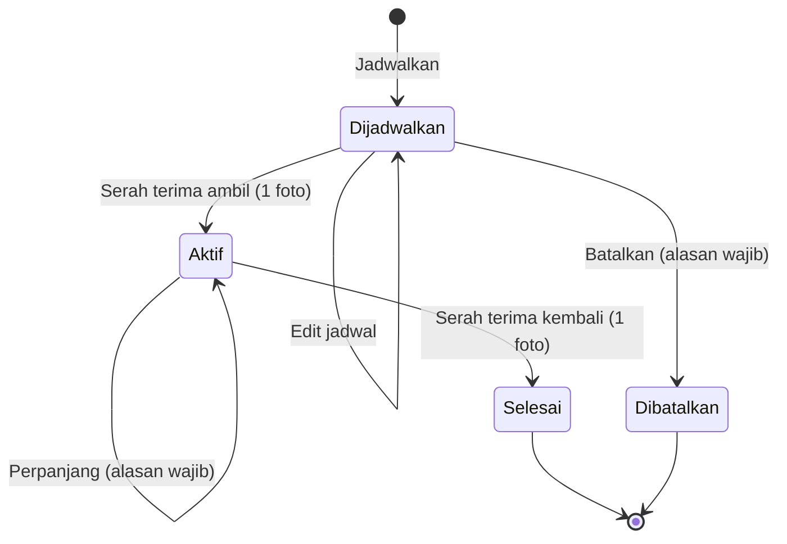
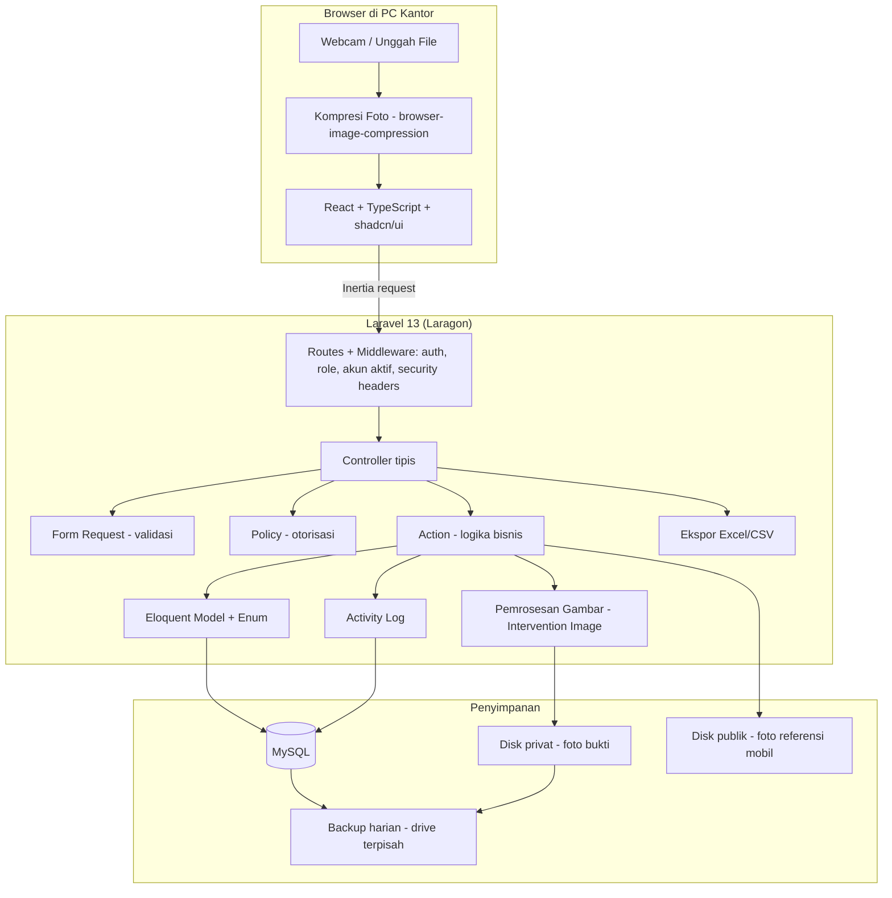
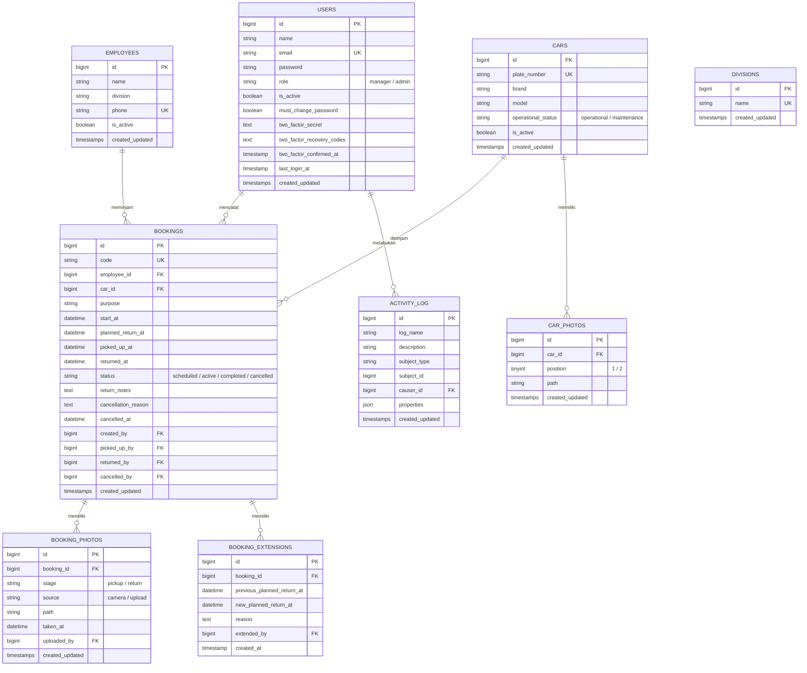

# PRD (Product Requirements Document)

# Sistem Peminjaman Mobil Dinas Internal

**Versi Dokumen:** 2.2
**Tanggal:** 22 Oktober 2026
**Status:** Siap dikembangkan

---

## Riwayat Perubahan

| Versi     | Tanggal                | Perubahan                                                                                                                                                                                                                                                                                                                                                                                                                                                                                                                                                                                                                                                                                                                                                                                                                                                       |
| --------- | ---------------------- | --------------------------------------------------------------------------------------------------------------------------------------------------------------------------------------------------------------------------------------------------------------------------------------------------------------------------------------------------------------------------------------------------------------------------------------------------------------------------------------------------------------------------------------------------------------------------------------------------------------------------------------------------------------------------------------------------------------------------------------------------------------------------------------------------------------------------------------------------------------- |
| 1.0 – 1.5 | Agustus – Oktober 2026 | Versi berbasis Next.js + Supabase + Vercel dengan karyawan sebagai pengguna aplikasi (self-service). Lihat dokumen PRD v1.5.                                                                                                                                                                                                                                                                                                                                                                                                                                                                                                                                                                                                                                                                                                                                    |
| 2.0       | 16 Oktober 2026        | **Perombakan total.** (1) Sistem berjalan **lokal di PC kantor** (Laragon) dengan rancangan siap deploy, menggantikan Supabase + Vercel. (2) Stack berganti ke **Laravel 13 + Inertia + React + TypeScript + shadcn/ui + MySQL**. (3) Sistem **hanya dioperasikan petugas GA**; karyawan tidak login dan hanya menjadi data. (4) Role menjadi **Pengelola** dan **Admin**. (5) Alur approve/tolak dihapus, diganti penjadwalan langsung oleh Admin + pembatalan. (6) **Odometer dihapus seluruhnya** (foto maupun angka); foto bukti menjadi **1 foto kondisi** per serah terima. (7) Ditambahkan: perpanjangan peminjaman, indikator Belum Diambil, log aktivitas, ekspor **Excel & CSV**, **light/dark mode**, backup otomatis.                                                                                                                               |
| 2.1       | 16 Oktober 2026        | Keputusan setelah analisis starter kit. (1) Lupa password lewat email, verifikasi email, dan passkey dinonaktifkan; reset password hanya oleh Pengelola, ditambah perintah artisan untuk Pengelola yang terkunci. (2) 2FA opsional, dapat diwajibkan untuk Pengelola lewat `.env`. (3) Kebijakan password minimal 10 karakter huruf + angka di semua environment; cek password bocor opsional lewat `.env`. (4) Aturan baru: toleransi waktu mulai 15 menit, serah terima ambil boleh lebih awal, edit jadwal boleh mengganti mobil/karyawan, perpanjangan tidak boleh memperpendek, serah terima ambil ditolak selama mobil belum kembali dari peminjaman sebelumnya. (5) Foto referensi mobil boleh menyusul. (6) Aturan format NIP dan no HP. (7) Tooling Vite+ (oxlint + oxfmt), font Inter lokal, bahasa `lang/id`. (8) Rencana pengerjaan menjadi 8 fase. |
| 2.2       | 22 Oktober 2026        | Penyelarasan sistem: (1) NIP (`employee_number`) dihilangkan dari data karyawan; identitas unik karyawan kini menggunakan No HP (`08xx`, unik). (2) Kolom NIP pada laporan ekspor riwayat digantikan No HP. (3) Master divisi dikelola secara dinamis via tabel database `divisions` dengan kemampuan tambah dan hapus langsung dari UI form karyawan. (4) Format ekspor riwayat peminjaman mendukung PDF selain Excel dan CSV.                                                                                                                                                                                                                                                                                                                                                                                                                                 |

---

## 1. Overview

### 1.1 Latar Belakang

Perusahaan memiliki armada mobil dinas yang dipakai karyawan untuk keperluan pekerjaan (kunjungan klien, dinas luar kota, dsb). Saat ini peminjaman dicatat secara manual lewat chat WhatsApp, buku catatan, atau spreadsheet. Akibatnya, tim General Affairs (GA) sulit melacak siapa memakai mobil apa, kapan harus kembali, dan bagaimana kondisi mobil sebelum dan sesudah dipakai.

Versi sebelumnya (v1.x) dirancang sebagai aplikasi online berbasis Supabase dan Vercel. Rancangan itu ditinggalkan karena:

- Supabase free tier membatasi database 500 MB dan **menghentikan sementara (pause) project yang tidak aktif selama 7 hari**, berisiko bagi sistem kantor yang tidak boleh mati.
- Paket gratis Vercel (Hobby) hanya untuk penggunaan pribadi non-komersial, sehingga tidak tepat untuk sistem perusahaan.
- Sistem harus tetap berjalan setelah pengembang (mahasiswa magang) selesai bertugas, **tanpa biaya bulanan dan tanpa ketergantungan pada akun pribadi pengembang**.

### 1.2 Tujuan Produk

Membangun sistem pencatatan peminjaman mobil dinas yang:

- Dioperasikan petugas GA untuk menjadwalkan, menyerahkan, dan menerima kembali mobil.
- Mencegah jadwal bentrok untuk mobil yang sama.
- Mendokumentasikan setiap serah terima dengan foto kondisi mobil bertanda waktu.
- Menandai peminjaman yang terlambat kembali secara otomatis.
- Menyediakan riwayat yang dapat ditelusuri dan laporan Excel/CSV untuk audit.
- Berjalan lokal di PC kantor tanpa biaya, namun **siap dipindahkan ke server** tanpa menulis ulang kode.

### 1.3 Ruang Lingkup

**Termasuk:**

- Pengelolaan akun petugas (Pengelola & Admin), data mobil, dan data karyawan.
- Penjadwalan, serah terima ambil, perpanjangan, serah terima kembali, dan pembatalan peminjaman.
- Dashboard, jadwal armada, riwayat, laporan, dan log aktivitas.
- Light mode dan dark mode.

**Tidak termasuk:**

- Akun atau login untuk karyawan peminjam.
- Registrasi akun, lupa password mandiri lewat email, verifikasi email, dan login dengan passkey.
- Pengajuan mandiri oleh karyawan dan alur persetujuan (approve/tolak).
- Pencatatan odometer dan perhitungan jarak tempuh.
- Notifikasi di luar aplikasi (WhatsApp, email, push notification).
- Tanda tangan digital peminjam.

### 1.4 Pengguna Sistem

| Role          | Deskripsi                                                                                                                                                              |
| ------------- | ---------------------------------------------------------------------------------------------------------------------------------------------------------------------- |
| **Pengelola** | Penanggung jawab sistem (misalnya kepala/koordinator GA). Memiliki semua hak Admin, ditambah mengelola akun petugas dan melihat log aktivitas. Disarankan 1–2 orang.   |
| **Admin**     | Petugas GA yang menjalankan operasional harian: menjadwalkan peminjaman, melakukan serah terima, mengelola data mobil dan karyawan, serta melihat riwayat dan laporan. |

**Karyawan peminjam bukan pengguna sistem.** Karyawan meminta mobil ke GA (WhatsApp, telepon, atau datang langsung), lalu Admin yang mencatat seluruh prosesnya. Data karyawan disimpan sebagai data master.

---

## 2. Requirements

### 2.1 Functional Requirements

#### Autentikasi & Akun

| Kode  | Requirement                                                                                                                                                                                                                                                                                                                     | Prioritas   |
| ----- | ------------------------------------------------------------------------------------------------------------------------------------------------------------------------------------------------------------------------------------------------------------------------------------------------------------------------------- | ----------- |
| FR-01 | Pengelola dan Admin login menggunakan email dan password. Hanya akun berstatus aktif yang dapat login. Tidak ada fitur registrasi, lupa password lewat email, verifikasi email, maupun passkey.                                                                                                                                 | Must Have   |
| FR-02 | Tersedia autentikasi dua faktor (2FA, aplikasi authenticator) per akun, opsional secara default. Dengan konfigurasi `FLEET_REQUIRE_2FA_FOR_MANAGER=true`, Pengelola wajib mengaktifkan 2FA sebelum dapat memakai aplikasi (diarahkan ke halaman pengaturan keamanan).                                                           | Should Have |
| FR-03 | Setiap petugas dapat mengubah nama dan mengganti password sendiri lewat halaman Profil. Email hanya dapat diubah oleh Pengelola.                                                                                                                                                                                                | Should Have |
| FR-04 | Pengelola dapat menambah, mengedit, menonaktifkan/mengaktifkan akun petugas, dan mereset password ke password sementara. Pemilik akun wajib mengganti password sementara saat login berikutnya. Reset password hanya dilakukan Pengelola (tidak ada lupa password lewat email). Daftar akun menampilkan status 2FA setiap akun. | Must Have   |
| FR-05 | Pengelola tidak dapat menonaktifkan akunnya sendiri, dan sistem menjaga minimal 1 akun Pengelola aktif. Akun yang dinonaktifkan langsung keluar dari sesi yang sedang berjalan. Jika tidak ada Pengelola yang dapat login, password Pengelola dapat direset lewat perintah artisan di PC/server aplikasi.                       | Must Have   |

#### Data Master

| Kode  | Requirement                                                                                                                                                                                                                                                                                                                                           | Prioritas |
| ----- | ----------------------------------------------------------------------------------------------------------------------------------------------------------------------------------------------------------------------------------------------------------------------------------------------------------------------------------------------------- | --------- |
| FR-06 | Admin dapat menambah, mengedit, dan menonaktifkan/mengaktifkan data mobil (plat nomor unik, merk, tipe). Mobil tidak dapat dihapus permanen dari aplikasi.                                                                                                                                                                                            | Must Have |
| FR-07 | Admin dapat mengubah status operasional mobil menjadi **Operasional** atau **Maintenance**. Mobil yang sedang dipinjam tidak dapat diubah ke Maintenance. Jika mobil punya jadwal mendatang, sistem menampilkan daftar jadwal tersebut sebagai peringatan.                                                                                            | Must Have |
| FR-08 | Setiap mobil memiliki slot 2 foto referensi (tampak depan/samping dan tampak belakang/interior) yang dapat dilihat lewat galeri popup (dialog) dengan navigasi sebelumnya/selanjutnya. Foto boleh menyusul: mobil dapat dibuat tanpa foto; slot kosong menampilkan placeholder, dan mobil diberi penanda **Foto belum lengkap** di daftar dan detail. | Must Have |
| FR-09 | Admin dapat menambah, mengedit, dan menonaktifkan/mengaktifkan data karyawan (nama, divisi, no HP unik). Pilihan divisi dikelola secara dinamis melalui master divisi (tambah dan hapus). Aturan data karyawan ada di section 5.4.                                                                                                                    | Must Have |
| FR-10 | Karyawan atau mobil yang masih memiliki peminjaman berjalan (status Dijadwalkan atau Aktif) tidak dapat dinonaktifkan. Sistem menampilkan peminjaman yang menghalangi.                                                                                                                                                                                | Must Have |

#### Peminjaman

| Kode  | Requirement                                                                                                                                                                                                                                                                                                                                                                                                                                        | Prioritas   |
| ----- | -------------------------------------------------------------------------------------------------------------------------------------------------------------------------------------------------------------------------------------------------------------------------------------------------------------------------------------------------------------------------------------------------------------------------------------------------- | ----------- |
| FR-11 | Admin dapat menjadwalkan peminjaman: memilih karyawan aktif, mobil aktif dan operasional, waktu mulai, rencana waktu kembali, serta tujuan/keperluan. Waktu mulai tidak boleh di masa lalu, kecuali dalam toleransi (default 15 menit, diatur di `config/fleet.php`) untuk karyawan yang datang langsung. Karyawan dan mobil dipilih lewat kotak pilihan yang dapat dicari; daftar mobil menampilkan ketersediaan pada rentang waktu yang dipilih. | Must Have   |
| FR-12 | Sistem menolak jadwal yang bentrok dengan peminjaman lain untuk mobil yang sama dan menampilkan peminjaman yang bertabrakan. Pengecekan aman terhadap input bersamaan oleh dua petugas.                                                                                                                                                                                                                                                            | Must Have   |
| FR-13 | Admin dapat mengedit jadwal selama status masih Dijadwalkan: mobil, karyawan, waktu mulai, rencana kembali, dan tujuan. Pengecekan bentrok dijalankan ulang setiap kali mobil atau waktu berubah; toleransi waktu mulai hanya diperiksa bila waktu mulai diubah. Nilai sebelum/sesudah dicatat di log aktivitas.                                                                                                                                   | Should Have |
| FR-14 | Admin dapat membatalkan peminjaman berstatus Dijadwalkan dengan alasan wajib diisi. Peminjaman Aktif tidak dapat dibatalkan.                                                                                                                                                                                                                                                                                                                       | Must Have   |
| FR-15 | **Serah terima ambil:** Admin mengambil 1 foto kondisi mobil (webcam atau unggah file). Setelah foto tersimpan, status menjadi Aktif. Serah terima boleh dilakukan sebelum waktu mulai (`start_at` tetap sebagai rencana, `picked_up_at` mencatat waktu aktual), tetapi ditolak jika mobil sedang Maintenance atau masih dalam peminjaman Aktif lain yang belum dikembalikan.                                                                      | Must Have   |
| FR-16 | **Serah terima kembali:** Admin mengambil 1 foto kondisi mobil dan dapat menambahkan catatan kondisi (misalnya kerusakan baru). Status menjadi Selesai.                                                                                                                                                                                                                                                                                            | Must Have   |
| FR-17 | Setiap foto bukti diberi timestamp otomatis dari server saat disimpan.                                                                                                                                                                                                                                                                                                                                                                             | Must Have   |
| FR-18 | **Perpanjangan:** Admin dapat memperpanjang rencana waktu kembali pada peminjaman Aktif dengan alasan wajib diisi. Rencana kembali yang baru wajib lebih lambat dari rencana kembali saat ini (tidak dapat memperpendek). Sistem mengecek bentrok dan menyimpan riwayat setiap perpanjangan.                                                                                                                                                       | Should Have |
| FR-19 | Detail peminjaman menampilkan foto sebelum dan sesudah secara berdampingan.                                                                                                                                                                                                                                                                                                                                                                        | Should Have |

#### Monitoring

| Kode  | Requirement                                                                                                                                                                                                                              | Prioritas   |
| ----- | ---------------------------------------------------------------------------------------------------------------------------------------------------------------------------------------------------------------------------------------- | ----------- |
| FR-20 | Dashboard menampilkan ringkasan armada (Tersedia, Dipinjam, Maintenance, Nonaktif), jadwal ambil dan kembali hari ini, daftar Terlambat, dan daftar Belum Diambil.                                                                       | Must Have   |
| FR-21 | Peminjaman Aktif yang melewati rencana waktu kembali otomatis ditampilkan sebagai **Terlambat** beserta lama keterlambatan dan no HP karyawan. Jumlahnya tampil sebagai badge di menu dan diperbarui berkala tanpa memuat ulang halaman. | Must Have   |
| FR-22 | Peminjaman Dijadwalkan yang melewati waktu mulai tetapi belum diserahterimakan ditampilkan sebagai **Belum Diambil**. Sistem tidak membatalkan otomatis.                                                                                 | Should Have |
| FR-23 | Jika mobil belum kembali dan mobil itu sudah punya jadwal berikutnya, jadwal berikutnya diberi peringatan agar Admin dapat memindahkan ke mobil lain. Serah terima ambil jadwal berikutnya itu ditolak sampai mobil dikembalikan.        | Should Have |
| FR-24 | Halaman **Jadwal Armada** menampilkan timeline mingguan per mobil: siapa memakai mobil apa, pada tanggal berapa.                                                                                                                         | Should Have |

#### Riwayat, Laporan & Audit

| Kode  | Requirement                                                                                                           | Prioritas   |
| ----- | --------------------------------------------------------------------------------------------------------------------- | ----------- |
| FR-25 | Riwayat peminjaman dapat dicari dan difilter berdasarkan periode, mobil, karyawan, divisi, status, dan keterlambatan. | Must Have   |
| FR-26 | Laporan dapat diekspor ke **Excel (.xlsx)**, **CSV**, dan **PDF**, mengikuti filter yang sedang aktif.                | Must Have   |
| FR-27 | Sistem mencatat log aktivitas (siapa membuat/mengubah apa dan kapan). Log dapat dilihat oleh Pengelola.               | Should Have |

#### Tampilan

| Kode  | Requirement                                                                                               | Prioritas   |
| ----- | --------------------------------------------------------------------------------------------------------- | ----------- |
| FR-28 | Pengguna dapat memilih tampilan **Light**, **Dark**, atau **Ikuti Sistem**. Pilihan tersimpan di browser. | Should Have |

### 2.2 Non-Functional Requirements

| Kode   | Requirement                                                                                                                                                                                                                                                                                                   |
| ------ | ------------------------------------------------------------------------------------------------------------------------------------------------------------------------------------------------------------------------------------------------------------------------------------------------------------- |
| NFR-01 | Foto dikompresi di browser sebelum diunggah (target ≤300 KB). Ukuran unggah maksimal 5 MB. Server memproses ulang gambar (maks. sisi terpanjang 1600 px) dan membuang metadata EXIF.                                                                                                                          |
| NFR-02 | Penyimpanan satu foto selesai dalam ≤3 detik di PC kantor.                                                                                                                                                                                                                                                    |
| NFR-03 | Seluruh halaman selain login hanya dapat diakses pengguna terautentikasi. Setiap aksi diperiksa hak aksesnya berdasarkan role (lihat section 9).                                                                                                                                                              |
| NFR-04 | Tampilan optimal di desktop/laptop (≥1280 px) dan tetap layak di tablet (≥768 px), sebagai persiapan jika kelak diakses dari perangkat lain.                                                                                                                                                                  |
| NFR-05 | Data dan foto disimpan minimal 1 tahun untuk audit. Tidak ada penghapusan permanen data transaksi dari aplikasi. Backup otomatis harian dengan retensi minimal 30 hari.                                                                                                                                       |
| NFR-06 | Aplikasi otomatis tersedia kembali setelah PC menyala ulang (Laragon autostart).                                                                                                                                                                                                                              |
| NFR-07 | Halaman daftar tetap merespons ≤1 detik dengan 10.000 transaksi (pagination di server dan index database).                                                                                                                                                                                                    |
| NFR-08 | Kode mengikuti standar format (Pint untuk PHP; oxlint + oxfmt lewat Vite+ untuk frontend), lolos analisis statis (Larastan) dan cek TypeScript, dan aturan bisnis utama tercakup feature test.                                                                                                                |
| NFR-09 | Semua konfigurasi yang berbeda antara lokal dan server diatur lewat `.env`, tanpa perubahan kode.                                                                                                                                                                                                             |
| NFR-10 | Kontras warna memadai di light dan dark mode. Status tidak hanya dibedakan lewat warna, tetapi juga teks/ikon.                                                                                                                                                                                                |
| NFR-11 | Antarmuka, pesan validasi, dan nama field berbahasa Indonesia (`lang/id`, ditulis manual). Zona waktu aplikasi `Asia/Jakarta` lewat `APP_TIMEZONE` dan dipakai konsisten untuk semua perhitungan waktu (Terlambat, Belum Diambil, toleransi waktu mulai). Format tanggal Indonesia (mis. 16 Okt 2026, 14.30). |

---

## 3. Core Features

### 3.1 Penjadwalan Peminjaman

Admin mencatat permintaan karyawan: memilih karyawan dan mobil (kotak pilihan yang dapat dicari), waktu mulai dan rencana kembali (pemilih tanggal & jam), serta tujuan. Waktu mulai tidak boleh di masa lalu, kecuali dalam toleransi 15 menit untuk karyawan yang datang langsung (diperiksa saat jadwal dibuat atau saat waktu mulainya diubah). Saat rentang waktu dipilih, daftar mobil menandai mobil yang tersedia pada rentang itu. Jika bentrok, sistem menolak dan menunjukkan peminjaman yang bertabrakan. Peminjaman berstatus **Dijadwalkan** masih bisa diedit (mobil, karyawan, waktu, tujuan) atau dibatalkan (dengan alasan).

### 3.2 Serah Terima & Foto Bukti (Fitur Utama)

Satu form serah terima yang menyesuaikan status:

- **Dijadwalkan → Serah Terima Ambil:** 1 foto kondisi mobil, status menjadi **Aktif**.
- **Aktif → Serah Terima Kembali:** 1 foto kondisi mobil + catatan kondisi opsional, status menjadi **Selesai**.

Serah terima ambil boleh dilakukan lebih awal dari waktu mulai, tetapi ditolak selama mobil sedang Maintenance atau masih dipakai peminjaman lain yang belum dikembalikan.

Foto dapat diambil langsung dengan **webcam** atau **diunggah dari file**. Foto dikompresi di browser, diproses ulang di server, disimpan di penyimpanan privat, dan diberi timestamp server. Detail peminjaman menampilkan foto sebelum dan sesudah berdampingan.

### 3.3 Perpanjangan

Jika karyawan mengabari akan kembali lebih lambat, Admin memperpanjang rencana kembali dengan alasan wajib. Rencana kembali baru wajib lebih lambat dari rencana saat ini. Sistem mengecek bentrok dengan jadwal lain, dan setiap perpanjangan tercatat (waktu lama, waktu baru, alasan, petugas).

### 3.4 Keterlambatan & Belum Diambil

- **Terlambat:** peminjaman Aktif yang melewati rencana kembali. Tampil di dashboard dengan lama keterlambatan dan no HP karyawan, serta badge di menu. Mobil tetap dianggap terpakai sampai serah terima kembali dilakukan. Setelah kembali, status menjadi Selesai, tetapi tetap ditandai terlambat beserta durasinya di riwayat dan laporan.
- **Belum Diambil:** peminjaman Dijadwalkan yang melewati waktu mulai. Admin memutuskan melanjutkan serah terima ambil atau membatalkan.

Keduanya **dihitung otomatis saat data ditampilkan**, sehingga tidak bergantung pada job terjadwal.

### 3.5 Dashboard & Jadwal Armada

Dashboard berisi ringkasan armada, jadwal ambil/kembali hari ini, daftar Terlambat, dan daftar Belum Diambil. Jadwal Armada menampilkan timeline mingguan per mobil.

### 3.6 Data Mobil

Plat nomor, merk, tipe, status operasional (Operasional/Maintenance), status aktif, dan 2 foto referensi dengan galeri popup (dialog dengan tombol sebelumnya/selanjutnya). Foto boleh menyusul; selama belum lengkap, tampil placeholder dan penanda **Foto belum lengkap**. Mobil tidak dihapus permanen, tetapi dinonaktifkan.

### 3.7 Data Karyawan

Nama, divisi, dan no HP (unik, disimpan dalam format `08xx`). Pilihan divisi dikelola secara dinamis melalui tabel `divisions` (dapat ditambah dan dihapus langsung oleh petugas dari form karyawan selama belum terpakai). Karyawan dinonaktifkan, bukan dihapus.

### 3.8 Riwayat & Laporan

Riwayat dengan pencarian dan filter, serta ekspor Excel, CSV, dan PDF sesuai filter. Kolom laporan: kode peminjaman, nama karyawan, divisi, no HP, mobil, plat nomor, tujuan, waktu mulai, rencana kembali, waktu ambil, waktu kembali, status, jumlah perpanjangan, durasi keterlambatan, petugas pencatat.

### 3.9 Kelola Petugas & Log Aktivitas (Pengelola)

Pengelola mengelola akun petugas dan melihat log aktivitas seluruh petugas.

### 3.10 Tampilan Light/Dark

Pengguna memilih Light, Dark, atau Ikuti Sistem dari menu pengaturan tampilan. Semua komponen memakai token warna yang terdefinisi untuk kedua mode.

---

ingat fokus pada akar permasalahan jangan over engginer, jangan merubah code atau bagian yang sudah benar, sesuai prinisip AGENTS.md dan hapus code mati yaitu komponen, import, dan file yang tidak terpakai.

## 4. Alur Penggunaan

### 4.1 Alur Peminjam (di luar aplikasi)

1. Karyawan menghubungi GA dan menyampaikan waktu pinjam, perkiraan kembali, dan tujuan.
2. GA mengabari karyawan mobil yang dijadwalkan.
3. Pada hari H, karyawan datang ke GA, menyaksikan Admin memotret kondisi mobil, lalu menerima kunci. Kerusakan yang sudah ada disampaikan saat itu.
4. Jika akan terlambat, karyawan mengabari GA.
5. Karyawan mengembalikan kunci, Admin memotret kondisi mobil, peminjaman selesai.

### 4.2 Alur Admin

1. Login, masuk ke Dashboard.
2. Menerima permintaan karyawan → **Jadwalkan Peminjaman** (status _Dijadwalkan_).
3. Hari H → **Serah Terima Ambil** + 1 foto (status _Aktif_).
4. Jika diminta → **Perpanjang** dengan alasan.
5. Mobil kembali → **Serah Terima Kembali** + 1 foto + catatan kondisi (status _Selesai_).
6. Bandingkan foto sebelum-sesudah; catat kerusakan jika ada.
7. Pantau Terlambat dan Belum Diambil di Dashboard; hubungi karyawan bila perlu.
8. Kelola data mobil dan karyawan; ekspor laporan.

### 4.3 Alur Pengelola

Semua alur Admin, ditambah:

1. Membuat akun petugas baru dan memberikan password sementara.
2. Mereset password, mengedit, atau menonaktifkan akun petugas.
3. Meninjau log aktivitas.

---

## 5. Aturan Bisnis

### 5.1 Status Peminjaman



| Status tersimpan | Nilai di kode | Keterangan                                |
| ---------------- | ------------- | ----------------------------------------- |
| Dijadwalkan      | `scheduled`   | Sudah dijadwalkan, kunci belum diserahkan |
| Aktif            | `active`      | Mobil sedang dipakai                      |
| Selesai          | `completed`   | Mobil sudah kembali                       |
| Dibatalkan       | `cancelled`   | Tidak jadi dipakai                        |

Transisi di luar diagram ditolak sistem.

**Indikator turunan (tidak disimpan, dihitung saat ditampilkan):**

| Indikator         | Kondisi                                                    |
| ----------------- | ---------------------------------------------------------- |
| Terlambat         | `status = active` dan `planned_return_at < sekarang`       |
| Belum Diambil     | `status = scheduled` dan `start_at < sekarang`             |
| Selesai Terlambat | `status = completed` dan `returned_at > planned_return_at` |

### 5.2 Pencegahan Bentrok

Dua peminjaman untuk mobil yang sama dianggap bentrok jika rentang waktunya tumpang tindih:

```
baru.start_at < lama.akhir  DAN  baru.planned_return_at > lama.start_at
```

- Peminjaman lama yang diperiksa hanya yang berstatus `scheduled` atau `active`.
- Untuk peminjaman `active` yang terlambat, `lama.akhir` = waktu sekarang (mobil dianggap terpakai sampai benar-benar kembali). Untuk lainnya, `lama.akhir` = `planned_return_at`.
- Pengecekan dan penyimpanan dilakukan dalam satu transaksi database dengan penguncian baris mobil (`lockForUpdate`), sehingga dua petugas yang menjadwalkan mobil yang sama secara bersamaan tidak bisa sama-sama berhasil.
- Berlaku untuk penjadwalan baru, edit jadwal, dan perpanjangan.
- Konsekuensi yang disengaja: mobil yang terlambat hanya memblokir jadwal yang dimulai sebelum mobil benar-benar kembali. Jadwal yang dimulai di masa mendatang tetap boleh dibuat dengan peringatan FR-23, tetapi serah terima ambilnya ditolak sampai peminjaman sebelumnya dikembalikan.
- Semua perbandingan waktu memakai waktu server aplikasi (`now()` dari PHP, zona `Asia/Jakarta`), bukan fungsi waktu MySQL.

### 5.3 Status Tampilan Mobil

Status mobil yang tampil di aplikasi diturunkan dengan urutan prioritas berikut (tidak disimpan ganda agar tidak pernah tidak sinkron):

1. **Nonaktif**: `is_active = false`
2. **Maintenance**: `operational_status = maintenance`
3. **Dipinjam**: ada peminjaman `active` untuk mobil ini
4. **Tersedia**: selain kondisi di atas

### 5.4 Aturan Lain

- Waktu rencana kembali harus setelah waktu mulai, dengan durasi minimal 30 menit. Tidak ada batas durasi maksimal; batas dapat ditetapkan kantor kemudian lewat `.env` (`FLEET_MAX_BOOKING_DAYS`) tanpa mengubah kode. Peminjaman lebih dari 7 hari (`FLEET_LONG_BOOKING_WARNING_DAYS`) hanya memunculkan konfirmasi "Pastikan tanggal sudah benar" di form, tanpa memblokir penyimpanan.
- Satu karyawan tidak boleh memiliki dua peminjaman Dijadwalkan/Aktif yang waktunya tumpang tindih, meskipun mobilnya berbeda.
- Tujuan minimal 5 karakter; alasan pembatalan dan perpanjangan minimal 10 karakter.
- Ekspor Riwayat wajib memilih periode dengan rentang maksimal 366 hari (diatur di `config/fleet.php`). Halaman Riwayat dibuka dengan periode bulan berjalan, dengan pilihan cepat Hari ini, 7 hari terakhir, Bulan ini, Bulan lalu, 3 bulan terakhir, dan Tahun ini.
- Waktu mulai tidak boleh lebih awal dari waktu sekarang dikurangi toleransi (default 15 menit, diatur di `config/fleet.php`). Berlaku untuk jadwal baru, dan untuk edit jadwal **hanya bila waktu mulai diubah**. Peminjaman yang sudah Belum Diambil tetap dapat diedit (tujuan, karyawan, mobil, rencana kembali) tanpa mengubah waktu mulai.
- Mobil Nonaktif disembunyikan dari pilihan jadwal; mobil Maintenance tetap tampil tetapi tidak dapat dipilih, dengan keterangan "Maintenance".
- Karyawan Nonaktif disembunyikan dari pilihan jadwal.
- Edit jadwal (hanya saat `scheduled`) boleh mengganti mobil, karyawan, waktu mulai, rencana kembali, dan tujuan. Pengecekan bentrok dijalankan ulang setiap kali mobil, waktu mulai, atau rencana kembali berubah; nilai sebelum/sesudah dicatat di log aktivitas.
- Serah terima ambil boleh sebelum `start_at` (`picked_up_at` = waktu aktual), tetapi ditolak jika mobil sedang Maintenance, mobil atau karyawan sudah nonaktif, atau mobil masih memiliki peminjaman `active` lain.
- Perpanjangan: rencana kembali baru wajib lebih lambat dari `planned_return_at` saat ini.
- Serah terima ambil dan kembali wajib menyertakan tepat 1 foto.
- Mobil boleh dibuat tanpa foto referensi (0–2 foto); slot kosong menampilkan placeholder dan penanda **Foto belum lengkap**.
- Data Karyawan: NIP dihilangkan. Identitas karyawan mencakup nama, divisi, dan no HP.
- No HP: wajib, unik sebagai identitas unik karyawan, diterima dalam format `08xx` atau `+62xx`, lalu dinormalisasi dan disimpan dalam format `08xx`. Panjang 10–15 digit dihitung **setelah** dinormalisasi ke `08xx`.
- Master Divisi: disimpan dalam tabel `divisions`. Petugas dapat menambah divisi baru atau menghapus divisi yang belum dipakai langsung dari dropdown form karyawan; penghapusan ditolak bila divisi masih terkait dengan data karyawan atau peminjaman.
- Penonaktifan karyawan/mobil ditolak jika masih ada peminjaman `scheduled` atau `active` (FR-10).
- Tidak ada penghapusan permanen untuk peminjaman, foto bukti, karyawan, mobil, atau akun petugas.
- Setiap peminjaman memiliki kode unik yang mudah dibaca, format `PMJ-YYYYMM-NNNN` (contoh: `PMJ-202610-0007`).

---

## 6. Arsitektur

### 6.1 Gambaran Umum

Aplikasi dibangun sebagai **monolith modular**: satu aplikasi Laravel yang menyajikan antarmuka React lewat Inertia. Tidak ada REST API terpisah, sehingga permukaan serangan lebih kecil dan perawatan lebih sederhana.



### 6.2 Pembagian Tanggung Jawab

| Lapisan          | Tanggung jawab                                                             | Tidak boleh berisi                  |
| ---------------- | -------------------------------------------------------------------------- | ----------------------------------- |
| **Controller**   | Menerima request, memanggil Action, mengembalikan halaman Inertia/redirect | Logika bisnis, query kompleks       |
| **Form Request** | Validasi input + pesan error berbahasa Indonesia                           | Logika bisnis                       |
| **Policy**       | Menentukan siapa boleh melakukan apa                                       | —                                   |
| **Action**       | Satu kelas untuk satu proses bisnis, dijalankan dalam transaksi bila perlu | Hal terkait HTTP (request/response) |
| **Model**        | Relasi, cast, scope query (`overdue`, `notPickedUp`, `overlapping`)        | Proses multi-langkah                |
| **Enum**         | Nilai status + label Indonesia + aturan transisi                           | —                                   |

**Daftar Action:**

| Domain     | Action                                                                                                             |
| ---------- | ------------------------------------------------------------------------------------------------------------------ |
| Peminjaman | `ScheduleBooking`, `UpdateBookingSchedule`, `CancelBooking`, `PickUpBooking`, `ExtendBooking`, `ReturnBooking`     |
| Mobil      | `CreateCar`, `UpdateCar`, `SetCarOperationalStatus`, `DeactivateCar`, `ActivateCar`, `ReplaceCarPhoto`             |
| Karyawan   | `CreateEmployee`, `UpdateEmployee`, `DeactivateEmployee`, `ActivateEmployee`                                       |
| Petugas    | `CreateStaffAccount`, `UpdateStaffAccount`, `ResetStaffPassword`, `DeactivateStaffAccount`, `ActivateStaffAccount` |
| Laporan    | `ExportBookings`                                                                                                   |

Selain Action, tersedia perintah artisan (`app/Console/Commands/`) untuk mereset password Pengelola yang terkunci.

### 6.3 Struktur Folder

```
app/
├── Actions/
│   ├── Booking/
│   ├── Car/
│   ├── Employee/
│   └── Staff/
├── Console/Commands/    # perintah artisan, mis. reset password Pengelola yang terkunci
├── Enums/               # BookingStatus, CarOperationalStatus, PhotoStage, PhotoSource, StaffRole
├── Exports/             # BookingsExport (Excel & CSV)
├── Http/
│   ├── Controllers/
│   ├── Middleware/      # EnsureAccountIsActive, EnsurePasswordChanged, EnsureTwoFactorEnabled, SecurityHeaders
│   └── Requests/
├── Models/
├── Policies/
└── Support/             # ImageProcessor, BookingCodeGenerator
config/
└── fleet.php            # batas ukuran foto, interval polling, toleransi waktu mulai, opsi keamanan (2FA Pengelola, cek password bocor)
lang/
└── id/                  # validation, auth, passwords, pagination + nama atribut (ditulis manual)
resources/
├── css/app.css          # token tema (light & dark) + token status tambahan
└── js/
    ├── components/ui/   # komponen shadcn — tidak diedit kecuali diperlukan
    ├── components/      # komponen aplikasi: PhotoCapture, StatusBadge, PhotoGallery, ...
    ├── layouts/
    ├── pages/           # dashboard/, bookings/, schedule/, history/, cars/, employees/, staff/, activity-log/, settings/
    └── types/
database/
├── migrations/
├── factories/
└── seeders/             # termasuk pembuatan akun Pengelola pertama
tests/
├── Feature/
└── Unit/
```

### 6.4 Konvensi Kode

- Kode (nama tabel, kolom, kelas, variabel) berbahasa **Inggris**; seluruh teks antarmuka berbahasa **Indonesia**.
- Nilai enum disimpan dalam bahasa Inggris, label tampilan diatur di enum, sehingga label dapat diubah tanpa mengubah data.
- Semua perubahan skema melalui migration, tidak pernah lewat edit tabel langsung.
- Semua akses file melalui `Storage::disk(...)`, tidak pernah lewat path absolut.

---

## 7. Sequence Diagram

### 7.1 Penjadwalan

```mermaid
sequenceDiagram
    actor Ad as Admin
    participant UI as React (Inertia)
    participant C as Controller
    participant A as ScheduleBooking
    participant DB as MySQL

    Ad->>UI: Isi karyawan, mobil, waktu, tujuan
    UI->>C: POST /bookings
    C->>C: Validasi (Form Request) + otorisasi (Policy)
    C->>A: execute(data)
    A->>DB: BEGIN; kunci baris mobil (lockForUpdate)
    A->>DB: Cek peminjaman tumpang tindih
    alt Bentrok
        A-->>C: Tolak + info peminjaman yang bertabrakan
        C-->>UI: Tampilkan error
    else Aman
        A->>DB: Simpan booking (scheduled) + log aktivitas; COMMIT
        C-->>UI: Redirect ke detail peminjaman
    end
```

### 7.2 Serah Terima (Ambil / Kembali)

```mermaid
sequenceDiagram
    actor Ad as Admin
    participant UI as React (Inertia)
    participant C as Controller
    participant A as PickUpBooking / ReturnBooking
    participant IMG as ImageProcessor
    participant ST as Disk Privat
    participant DB as MySQL

    Ad->>UI: Ambil foto (webcam) atau pilih file
    UI->>UI: Kompresi foto di browser
    UI->>C: POST /bookings/{id}/pickup atau /return
    C->>C: Validasi file (tipe dari isi file, ukuran) + otorisasi
    C->>A: execute(booking, foto)
    A->>A: Cek transisi status valid
    A->>IMG: Re-encode, resize, buang EXIF
    IMG->>ST: Simpan dengan nama acak (UUID)
    A->>DB: Simpan booking_photos (timestamp server) + update status + log; COMMIT
    C-->>UI: Redirect ke detail peminjaman
```

### 7.3 Pembaruan Badge Terlambat

```mermaid
sequenceDiagram
    participant UI as Layout (React)
    participant C as Laravel
    participant DB as MySQL

    loop Setiap 60 detik (polling Inertia, hanya data badge)
        UI->>C: Muat ulang prop jumlah Terlambat & Belum Diambil
        C->>DB: COUNT active & planned_return_at < now; COUNT scheduled & start_at < now
        DB-->>C: Jumlah
        C-->>UI: Perbarui badge di menu
    end
```

---

## 8. Database Schema

### 8.1 ERD



### 8.2 Catatan Tabel

| Tabel                | Catatan                                                                                                                                                                                                                                                           |
| -------------------- | ----------------------------------------------------------------------------------------------------------------------------------------------------------------------------------------------------------------------------------------------------------------- |
| `users`              | Akun petugas (Pengelola & Admin). Memakai tabel bawaan Laravel agar kompatibel dengan Fortify. Nilai `role`: `manager` (label: Pengelola), `admin` (label: Admin). Tabel `passkeys` bawaan starter kit dihapus lewat migration baru karena passkey tidak dipakai. |
| `employees`          | Data master karyawan peminjam, tanpa kredensial login. NIP dihilangkan; `phone` unik dan disimpan ternormalisasi dalam format `08xx`. `division` disimpan sebagai teks sesuai master divisi.                                                                      |
| `divisions`          | Master pilihan divisi dinamis. `name` unik (maks. 50 karakter). Petugas dapat menambah atau menghapus divisi langsung dari UI dropdown form selama tidak digunakan karyawan.                                                                                      |
| `cars`               | `operational_status` hanya menyimpan kondisi operasional. Status "Dipinjam" diturunkan dari peminjaman aktif (section 5.3).                                                                                                                                       |
| `car_photos`         | 0–2 baris per mobil (foto boleh menyusul), unik pada (`car_id`, `position`). Disimpan di disk publik.                                                                                                                                                             |
| `bookings`           | `code` unik format `PMJ-YYYYMM-NNNN`. `planned_return_at` selalu berisi nilai terbaru setelah perpanjangan.                                                                                                                                                       |
| `booking_photos`     | Maksimal 2 baris per peminjaman, unik pada (`booking_id`, `stage`). Disimpan di disk privat. `taken_at` = waktu server saat disimpan.                                                                                                                             |
| `booking_extensions` | Riwayat setiap perpanjangan.                                                                                                                                                                                                                                      |
| `activity_log`       | Dikelola paket `spatie/laravel-activitylog`.                                                                                                                                                                                                                      |

### 8.3 Index & Constraint

- `bookings (car_id, status, start_at, planned_return_at)` untuk cek bentrok.
- `bookings (status, planned_return_at)` untuk daftar Terlambat.
- `bookings (status, start_at)` untuk daftar Belum Diambil.
- `bookings (employee_id)` dan `bookings (start_at)` untuk filter riwayat.
- `employees (phone)` unik sebagai pengenal unik karyawan.
- `divisions (name)` unik.
- Semua foreign key memakai `restrictOnDelete`, sehingga data yang memiliki riwayat tidak dapat terhapus.

---

## 9. Hak Akses

| Fitur                                    | Pengelola | Admin |
| ---------------------------------------- | :-------: | :---: |
| Dashboard, Jadwal Armada                 |    ✅     |  ✅   |
| Jadwalkan, edit, batalkan peminjaman     |    ✅     |  ✅   |
| Serah terima ambil & kembali, perpanjang |    ✅     |  ✅   |
| Lihat foto bukti                         |    ✅     |  ✅   |
| Kelola data mobil & karyawan             |    ✅     |  ✅   |
| Riwayat & ekspor Excel/CSV               |    ✅     |  ✅   |
| Profil & ganti password sendiri          |    ✅     |  ✅   |
| Kelola akun petugas                      |    ✅     |  ❌   |
| Lihat log aktivitas                      |    ✅     |  ❌   |

Hak akses diterapkan di Policy dan middleware, bukan hanya dengan menyembunyikan menu. Role baru (misalnya Viewer) dapat ditambahkan kemudian tanpa membongkar struktur.

---

## 10. Keamanan

### 10.1 Autentikasi & Sesi

- Autentikasi memakai Laravel Fortify bawaan starter kit. Fitur registrasi, lupa password lewat email, verifikasi email, dan passkey dinonaktifkan seluruhnya (route, UI, tautan, dan konfigurasi). Paket `@laravel/passkeys` dihapus.
- Password di-hash (bcrypt/argon2) dengan kebijakan minimal 10 karakter, kombinasi huruf dan angka, berlaku sama di semua environment. Pengecekan password bocor (HIBP, butuh internet) dapat diaktifkan lewat `FLEET_PASSWORD_CHECK_UNCOMPROMISED` (default `false`).
- Rate limit login: 5 percobaan per menit per kombinasi email + IP.
- 2FA (TOTP) tersedia dan opsional. `FLEET_REQUIRE_2FA_FOR_MANAGER=true` (default `false`) mewajibkannya untuk Pengelola: Pengelola tanpa 2FA aktif diarahkan ke halaman pengaturan keamanan sampai 2FA diaktifkan.
- Kedua opsi `FLEET_*` di atas dibaca lewat `config/fleet.php` dan **disarankan `true` bila sistem dapat diakses dari internet**.
- Sesi berakhir setelah 120 menit tidak aktif. Session ID diregenerasi saat login.
- Middleware memeriksa `is_active` di setiap request; akun yang dinonaktifkan langsung keluar.
- Password sementara memaksa penggantian password saat login berikutnya.
- Akun Pengelola pertama dibuat lewat seeder/perintah artisan dengan password yang wajib diganti.
- Reset password hanya oleh Pengelola (password sementara yang wajib diganti). Pengelola yang terkunci direset lewat perintah artisan (tersedia sejak Fase 2), dan hasilnya juga wajib diganti saat login berikutnya.

### 10.2 Otorisasi

- Setiap aksi melewati Policy, termasuk akses file foto bukti.
- Mass assignment dilindungi dengan `$fillable` eksplisit.

### 10.3 Unggah Foto

- Validasi tipe berdasarkan isi file (MIME sniffing), hanya JPEG/PNG/WebP, maks. 5 MB.
- Gambar diproses ulang di server: resize, re-encode, dan buang metadata EXIF. Proses ini sekaligus menetralkan payload yang disisipkan di file.
- Nama file diganti UUID; nama asli dari pengguna tidak pernah dipakai.
- Foto bukti disimpan di disk privat (di luar `public/`) dan hanya disajikan lewat route yang mewajibkan login dan lolos Policy.
- Struktur path: `bookings/{tahun}/{bulan}/{uuid}.jpg` (privat), `cars/{uuid}.jpg` (publik).

### 10.4 Lapisan Web

- CSRF ditangani otomatis oleh Laravel + Inertia.
- XSS dicegah oleh escaping bawaan React; `dangerouslySetInnerHTML` tidak digunakan, termasuk untuk QR 2FA (ditampilkan sebagai gambar `data:` URI).
- SQL injection dicegah dengan Eloquent/query builder (parameter binding); tidak ada raw query dengan input pengguna.
- Middleware security headers: `Content-Security-Policy`, `X-Frame-Options: DENY`, `X-Content-Type-Options: nosniff`, `Referrer-Policy: strict-origin-when-cross-origin`, `Permissions-Policy` (kamera hanya untuk origin sendiri). Tidak ada aset dari CDN eksternal (font dibundel lokal), sehingga CSP cukup mengizinkan origin sendiri.

### 10.5 Konfigurasi & Data

- `.env` tidak masuk Git; `APP_DEBUG=false` di luar development.
- MySQL memakai user khusus aplikasi dengan hak akses hanya ke database aplikasi, **bukan `root`**. Pemakaian `root` saat ini sengaja dan sementara untuk development lokal; diganti di Fase 8 sebelum dipakai.
- Pemeriksaan kerentanan dependensi rutin: `composer audit` dan `npm audit`.
- Backup harian database + folder foto ke drive terpisah; uji restore minimal sekali sebulan.
- Log aktivitas tidak dapat diubah atau dihapus dari aplikasi.

---

## 11. UI/UX

### 11.1 Fondasi Desain

- **shadcn/ui** dari starter kit React Laravel, dengan preset dari shadcn/create: **Style: Nova**, **Base Color: Neutral**, **Theme: Blue** (kode preset `b1PzeK`).
- Preset diterapkan sekali di awal project lewat `npx shadcn@latest apply --preset b1PzeK`, sebelum komponen apa pun dimodifikasi.
- Warna biru (primary) dipakai untuk aksi utama, elemen aktif, focus ring, dan chart. Latar, kartu, border, dan teks memakai warna netral.
- Ikon: Lucide.
- Font: **Inter** yang dibundel lokal (`@fontsource-variable/inter`), tanpa pemanggilan font dari CDN eksternal.

### 11.2 Light & Dark Mode

- Tiga pilihan: Light, Dark, Ikuti Sistem, tersedia di menu pengaturan tampilan (memanfaatkan fitur appearance starter kit).
- Seluruh token warna didefinisikan untuk kedua mode di `resources/css/app.css`.
- Komponen hanya memakai token semantik (`bg-primary`, `text-muted-foreground`, `border-border`, dst). Warna langsung seperti `bg-blue-600` tidak dipakai.
- Setiap halaman diuji di kedua mode.

### 11.3 Token Status Tambahan

shadcn bawaan hanya memiliki token `destructive`. Ditambahkan token **`success`** dan **`warning`** (beserta `-foreground`) untuk light dan dark mode.

| Status                        | Token         | Keterangan    |
| ----------------------------- | ------------- | ------------- |
| Tersedia, Selesai             | `success`     | Hijau         |
| Dijadwalkan, Aktif / Dipinjam | `primary`     | Biru          |
| Maintenance, Belum Diambil    | `warning`     | Kuning/oranye |
| Terlambat                     | `destructive` | Merah         |
| Dibatalkan, Nonaktif          | `muted`       | Abu-abu       |

Badge status selalu menampilkan teks (dan ikon), tidak hanya warna.

### 11.4 Halaman

| Menu           | Isi                                                                                         | Akses     |
| -------------- | ------------------------------------------------------------------------------------------- | --------- |
| Dashboard      | Ringkasan armada, jadwal hari ini, Terlambat, Belum Diambil                                 | Semua     |
| Jadwal Armada  | Timeline mingguan per mobil                                                                 | Semua     |
| Peminjaman     | Daftar peminjaman berjalan + aksi sesuai status; form jadwal; detail + foto sebelum-sesudah | Semua     |
| Riwayat        | Pencarian, filter, ekspor Excel/CSV                                                         | Semua     |
| Data Mobil     | Daftar, form, foto referensi (boleh menyusul, penanda Foto belum lengkap), galeri           | Semua     |
| Data Karyawan  | Daftar, form, aktif/nonaktif                                                                | Semua     |
| Kelola Petugas | Daftar akun (termasuk status 2FA), form, reset password, aktif/nonaktif                     | Pengelola |
| Log Aktivitas  | Daftar aktivitas dengan filter                                                              | Pengelola |
| Pengaturan     | Profil, password, 2FA, tampilan                                                             | Semua     |

### 11.5 Prinsip Interaksi

- Bahasa antarmuka ramah pengguna non-teknis, tanpa jargon teknis (kode FR, nama tabel, path storage).
- Dialog dengan form atau unggahan tidak tertutup saat klik di luar area (backdrop), agar input tidak hilang.
- Aksi berisiko (batalkan, nonaktifkan, reset password) memakai dialog konfirmasi.
- Pesan sukses/gagal memakai toast (Sonner).
- Tabel memakai pagination server, pencarian, dan filter.
- Empty state yang jelas di setiap daftar.
- Input tanggal/waktu memakai pemilih tanggal berbasis shadcn (`calendar` + `popover`, react-day-picker + date-fns) dengan locale Indonesia, tampilan hari/bulan/tahun, dan pemilih jam-menit.
- Pemilihan karyawan dan mobil memakai combobox yang dapat dicari (shadcn `command`).
- Galeri foto referensi memakai dialog dengan tombol sebelumnya/selanjutnya, tanpa komponen carousel.

### 11.6 Pengambilan Foto

Komponen `PhotoCapture` menyediakan dua pilihan: **Ambil dengan Kamera** (webcam via `getUserMedia`) dan **Unggah File**. Pratinjau foto ditampilkan sebelum disimpan, dengan opsi ambil ulang.

> **Catatan teknis:** browser hanya mengizinkan akses kamera di _secure context_ (HTTPS atau `localhost`). Aplikasi diakses lewat `localhost` atau domain lokal Laragon dengan SSL diaktifkan. Opsi Unggah File tetap berfungsi di kondisi apa pun.

---

## 12. Tech Stack

| Layer                    | Teknologi                                                          | Keterangan                                                                                 |
| ------------------------ | ------------------------------------------------------------------ | ------------------------------------------------------------------------------------------ |
| Backend                  | Laravel 13 (PHP sesuai syarat Laravel 13)                          | Framework utama                                                                            |
| Frontend                 | React + TypeScript (strict) via Inertia.js                         | Versi mengikuti starter kit resmi React Laravel                                            |
| Routing frontend         | Laravel Wayfinder (bawaan starter kit)                             | Fungsi TypeScript bertipe untuk route Laravel                                              |
| UI                       | shadcn/ui (preset Nova + Neutral + Blue), Tailwind CSS v4, Lucide  | Combobox lewat shadcn `command` (`cmdk`)                                                   |
| Font                     | Inter (`@fontsource-variable/inter`)                               | Dibundel lokal, tanpa CDN                                                                  |
| Bahasa                   | `lang/id` ditulis manual                                           | Tanpa paket terjemahan                                                                     |
| Autentikasi              | Laravel Fortify (bawaan starter kit)                               | Login, 2FA, ganti password; tanpa registrasi, lupa password, verifikasi email, dan passkey |
| Database                 | MySQL 8 (Laragon)                                                  |                                                                                            |
| Penyimpanan file         | Laravel Filesystem — disk `local` (privat) & `public`              | Dapat dialihkan ke S3/MinIO lewat `.env`                                                   |
| Kompresi foto (client)   | `browser-image-compression`                                        |                                                                                            |
| Pemrosesan foto (server) | `intervention/image`                                               | Resize, re-encode, buang EXIF                                                              |
| Ekspor                   | `maatwebsite/excel`                                                | Excel (.xlsx) & CSV                                                                        |
| Log aktivitas            | `spatie/laravel-activitylog`                                       |                                                                                            |
| Backup                   | `spatie/laravel-backup`                                            | Database + folder foto                                                                     |
| Testing                  | Pest                                                               | Feature & unit test, memakai database MySQL terpisah `peminjaman_mobil_test`               |
| Kualitas kode            | Laravel Pint, Larastan, oxlint + oxfmt (Vite+, bawaan starter kit) | Tanpa ESLint/Prettier                                                                      |
| Server lokal             | Laragon (Windows)                                                  | Apache/Nginx + PHP + MySQL                                                                 |
| Version control          | Git + GitHub/GitLab                                                | CI: test & lint di setiap push                                                             |

**Biaya:** Rp0/bulan. Seluruh komponen open-source dan berjalan di PC kantor.

---

## 13. Deployment & Operasional

### 13.1 Lingkungan Lokal (Saat Ini)

- Aplikasi berjalan di satu PC kantor dengan Laragon, diakses dari browser di PC tersebut.
- Pengembangan: `composer run dev`, diakses di `http://localhost:8000` (`APP_URL=http://localhost:8000`).
- Pemakaian di PC kantor (disiapkan di Fase 8): SSL Laragon dengan domain `.test` agar webcam berfungsi. Folder project diganti nama menjadi `sistem-peminjaman-mobil` karena garis bawah tidak valid untuk hostname, sehingga alamatnya `https://sistem-peminjaman-mobil.test`. Langkah rename folder dicatat di README.
- `APP_TIMEZONE=Asia/Jakarta` dipakai konsisten di semua lingkungan, karena aturan Terlambat, Belum Diambil, dan toleransi waktu mulai bergantung pada jam server.
- Laragon diatur **autostart** saat Windows menyala.
- Antrean dan scheduler dijalankan lewat Windows Task Scheduler (`php artisan schedule:run` setiap menit).
- Backup harian (`spatie/laravel-backup`) ke drive terpisah atau penyimpanan jaringan kantor; retensi minimal 30 hari.

### 13.2 Kesiapan Deploy ke Server

Semua perbedaan lingkungan dikendalikan lewat `.env`:

| Aspek                                | Lokal (Laragon)                                                                             | Server (nanti)                                                                   |
| ------------------------------------ | ------------------------------------------------------------------------------------------- | -------------------------------------------------------------------------------- |
| `APP_ENV` / `APP_DEBUG`              | `local` / `true` saat pengembangan, `production` / `false` saat dipakai                     | `production` / `false`                                                           |
| Database                             | MySQL lokal                                                                                 | MySQL server                                                                     |
| Penyimpanan foto                     | Disk lokal                                                                                  | S3 / MinIO (`FILESYSTEM_DISK`)                                                   |
| Queue                                | Driver `database`                                                                           | Redis                                                                            |
| Scheduler                            | Windows Task Scheduler                                                                      | cron `schedule:run`                                                              |
| HTTPS                                | SSL lokal Laragon / `localhost`                                                             | Wajib (mis. Let's Encrypt)                                                       |
| Cookie sesi                          | Default                                                                                     | `SESSION_SECURE_COOKIE=true`                                                     |
| `APP_URL`                            | `http://localhost:8000` (pengembangan) / `https://sistem-peminjaman-mobil.test` (PC kantor) | Domain server dengan HTTPS                                                       |
| `APP_TIMEZONE`                       | `Asia/Jakarta`                                                                              | `Asia/Jakarta`                                                                   |
| `FLEET_REQUIRE_2FA_FOR_MANAGER`      | `false`                                                                                     | `true` disarankan bila dapat diakses dari internet                               |
| `FLEET_PASSWORD_CHECK_UNCOMPROMISED` | `false`                                                                                     | `true` disarankan bila dapat diakses dari internet (server butuh akses internet) |

Langkah pindah server: `git clone/pull` → isi `.env` → `composer install --no-dev` → `npm ci && npm run build` → `php artisan migrate --force` → pindahkan folder foto → `php artisan optimize`.

### 13.3 Serah Terima Sistem

README project wajib berisi:

- Cara instalasi dari nol di Laragon, termasuk rename folder ke `sistem-peminjaman-mobil` dan mengaktifkan SSL Laragon.
- Cara membuat akun Pengelola pertama dan mereset password Pengelola jika terkunci (perintah artisan).
- Bagian **Pindah ke server**, termasuk anjuran `FLEET_REQUIRE_2FA_FOR_MANAGER=true` dan `FLEET_PASSWORD_CHECK_UNCOMPROMISED=true` bila sistem dapat diakses dari internet.
- Lokasi folder foto dan cara backup serta restore.
- Daftar perintah perawatan rutin.
- Cara mengelola (tambah dan hapus) pilihan divisi langsung dari aplikasi.

---

## 14. Kualitas & Pengujian

### 14.1 Feature Test Wajib

- Penjadwalan ditolak saat bentrok, termasuk dengan peminjaman aktif yang terlambat.
- Transisi status yang tidak valid ditolak.
- Serah terima tanpa foto ditolak; foto dengan tipe tidak valid ditolak.
- Perpanjangan ditolak saat bentrok.
- Penonaktifan karyawan/mobil ditolak saat ada peminjaman berjalan.
- Admin tidak dapat mengakses Kelola Petugas dan Log Aktivitas.
- Foto bukti tidak dapat diakses tanpa login.
- Akun nonaktif tidak dapat login dan sesinya berakhir.
- Pengelola terakhir tidak dapat dinonaktifkan.
- Ekspor menghasilkan data sesuai filter.
- Waktu mulai di masa lalu ditolak, kecuali dalam toleransi; peminjaman Belum Diambil tetap dapat diedit tanpa mengubah waktu mulai.
- Serah terima ambil ditolak selama mobil masih dipakai peminjaman Aktif lain.
- Perpanjangan yang tidak lebih lambat dari rencana kembali saat ini ditolak.
- Edit jadwal mencatat nilai sebelum/sesudah di log aktivitas.
- Route registrasi, lupa password, verifikasi email, dan passkey tidak tersedia.
- Pengelola tanpa 2FA diarahkan ke halaman keamanan saat `FLEET_REQUIRE_2FA_FOR_MANAGER=true`.
- No HP dinormalisasi ke format `08xx`, wajib unik, dan panjangnya dihitung setelah normalisasi; No HP duplikat ditolak.

### 14.2 Standar

- Pint (PHP) dan Vite+ (`npm run check`: oxlint + oxfmt) lolos sebelum commit.
- Larastan minimal level 6 (saat ini level 7).
- TypeScript mode strict, tanpa `any` yang tidak beralasan.
- Test memakai database MySQL terpisah `peminjaman_mobil_test` (diatur di `phpunit.xml`), tidak pernah database aplikasi.
- CI (GitHub Actions) menjalankan Pint, Larastan, test (dengan service MySQL), `npm run check`, dan `npm run types:check` di setiap push.

---

## 15. Keputusan Desain & Opsi yang Dibatalkan

| Keputusan                                                                 | Alasan                                                                                                                                                                                                   |
| ------------------------------------------------------------------------- | -------------------------------------------------------------------------------------------------------------------------------------------------------------------------------------------------------- |
| **Self-host lokal (Laragon) alih-alih Supabase + Vercel**                 | Menghindari pause project, batas penyimpanan, ketidaksesuaian paket gratis untuk penggunaan perusahaan, dan ketergantungan pada akun pribadi pengembang.                                                 |
| **Laravel + Inertia alih-alih Next.js**                                   | Satu aplikasi tanpa API terpisah; berjalan langsung di Laragon tanpa proses Node yang harus terus hidup; fitur auth, upload, validasi, dan scheduler sudah tersedia; lebih mudah dirawat staf IT kantor. |
| **Hanya petugas GA yang memakai sistem**                                  | Sistem lokal di satu PC; karyawan tidak perlu akun. Kompleksitas (registrasi, approval, notifikasi user, navigasi user) hilang.                                                                          |
| **Approve/tolak dihapus**                                                 | Admin langsung memutuskan saat menjadwalkan; pembatalan dengan alasan menggantikan penolakan.                                                                                                            |
| **Odometer dihapus**                                                      | Menyederhanakan serah terima. Konsekuensi: tidak ada laporan jarak tempuh. Dapat ditambahkan kembali sebagai isian opsional tanpa mengubah alur.                                                         |
| **1 foto kondisi per serah terima**                                       | Cukup sebagai bukti dan mempercepat proses.                                                                                                                                                              |
| **Tanpa tanda tangan digital**                                            | Menjaga serah terima tetap singkat; foto bertanda waktu dan petugas pencatat menjadi bukti.                                                                                                              |
| **Ekspor Excel, CSV & PDF**                                               | Sesuai kebutuhan pengolahan data GA (analisis via spreadsheet dan cetak laporan/arsip via PDF).                                                                                                          |
| **Status Terlambat & Belum Diambil dihitung, bukan disimpan**             | Tidak bergantung pada job terjadwal dan tidak pernah tidak sinkron.                                                                                                                                      |
| **Status Dipinjam pada mobil diturunkan dari peminjaman**                 | Satu sumber kebenaran; mencegah data ganda yang bisa berbeda.                                                                                                                                            |
| **Soft deactivation, tanpa hapus permanen**                               | Menjaga integritas riwayat dan bukti audit.                                                                                                                                                              |
| **Divisi di tabel dinamis, bukan file konfigurasi**                       | Memudahkan petugas menambah/menghapus divisi langsung dari form input tanpa perlu mengubah file konfigurasi di server.                                                                                   |
| **Polling untuk badge, bukan realtime/websocket**                         | Cukup untuk beberapa petugas; tanpa server tambahan.                                                                                                                                                     |
| **Tidak ada notifikasi WhatsApp/email**                                   | Sistem lokal; pemberitahuan cukup di dalam aplikasi.                                                                                                                                                     |
| **Tanpa lupa password lewat email, verifikasi email, dan passkey**        | Sistem tidak mengirim email; reset dilakukan Pengelola (perintah artisan untuk Pengelola yang terkunci). Passkey menambah permukaan serangan tanpa kebutuhan nyata.                                      |
| **2FA dan cek password bocor diatur lewat `.env`**                        | Default longgar untuk PC kantor yang offline; dapat diperketat tanpa ubah kode saat sistem bisa diakses dari internet.                                                                                   |
| **Tooling Vite+ (oxlint + oxfmt) bawaan starter kit**                     | Menghindari dependensi tambahan ESLint/Prettier.                                                                                                                                                         |
| **Font Inter lokal, galeri tanpa carousel**                               | Tetap berfungsi tanpa internet, CSP lebih ketat, dan tanpa dependensi tambahan.                                                                                                                          |
| **Pemilih tanggal shadcn (react-day-picker + date-fns)**                  | Menggantikan `datetime-local` bawaan browser yang tampilannya berbeda-beda antar-browser; dibundel lokal sehingga tetap berfungsi tanpa internet.                                                        |
| **Tanpa microservices, repository pattern berlapis, atau Docker di awal** | Skala kecil; kompleksitas tambahan justru mempersulit perawatan. Struktur tetap siap dikembangkan.                                                                                                       |

---

## 16. Rencana Pengerjaan

| Fase                          | Cakupan                                                                                                                                                                                                                                                                                                                                                                                                                                    |
| ----------------------------- | ------------------------------------------------------------------------------------------------------------------------------------------------------------------------------------------------------------------------------------------------------------------------------------------------------------------------------------------------------------------------------------------------------------------------------------------ |
| 1. Fondasi                    | Penyesuaian starter kit: nonaktifkan registrasi, lupa password, verifikasi email, dan passkey (+ hapus `@laravel/passkeys`, migration drop `passkeys`); role & kolom akun; middleware akun aktif, ganti password, 2FA Pengelola, security headers; kebijakan password & opsi `FLEET_*`; zona waktu & `lang/id`; token status + `StatusBadge`; font Inter lokal; layout & menu Indonesia; `config/fleet.php`; seeder Pengelola; workflow CI |
| 2. Akun Petugas               | Kelola Petugas (termasuk status 2FA), password sementara, nonaktif + akhiri sesi, minimal 1 Pengelola aktif, profil, perintah artisan reset password Pengelola, mulai pencatatan log aktivitas                                                                                                                                                                                                                                             |
| 3. Data Master                | Data Mobil (+ status operasional, foto referensi yang boleh menyusul, galeri), Data Karyawan (nama, divisi, no HP unik), Master Divisi dinamis                                                                                                                                                                                                                                                                                             |
| 4. Inti Peminjaman            | Penjadwalan + cek bentrok, edit, batal, serah terima ambil/kembali + foto, perpanjangan, detail + perbandingan foto                                                                                                                                                                                                                                                                                                                        |
| 5. Monitoring                 | Dashboard, badge Terlambat/Belum Diambil, peringatan jadwal berikutnya, Jadwal Armada                                                                                                                                                                                                                                                                                                                                                      |
| 6. Riwayat & Laporan          | Riwayat + filter, ekspor Excel/CSV/PDF, halaman Log Aktivitas                                                                                                                                                                                                                                                                                                                                                                              |
| 7. Audit Kualitas & Keamanan  | Kepatuhan PRD/AGENTS, matriks test hak akses, review keamanan, performa, `composer audit`/`npm audit`                                                                                                                                                                                                                                                                                                                                      |
| 8. Operasional & Serah Terima | Backup otomatis, scheduler, autostart, SSL Laragon + rename folder, user MySQL khusus, README & panduan pengguna, uji restore                                                                                                                                                                                                                                                                                                              |

Prompt rinci tiap fase ada di `PROMPTS.md`.

---

## Lampiran A: Ringkasan Prioritas (MoSCoW)

| Prioritas              | Fitur                                                                                                                                                                                                                                                                                                                          |
| ---------------------- | ------------------------------------------------------------------------------------------------------------------------------------------------------------------------------------------------------------------------------------------------------------------------------------------------------------------------------ |
| Must Have              | Login petugas, kelola petugas + proteksi, data mobil (+ status operasional, foto referensi & galeri), data karyawan, master divisi, proteksi nonaktif, penjadwalan + cek bentrok, pembatalan, serah terima ambil & kembali (1 foto), timestamp foto, dashboard, indikator Terlambat, riwayat + filter, ekspor Excel, CSV & PDF |
| Should Have            | 2FA, profil & ganti password, edit jadwal, perpanjangan, perbandingan foto, Belum Diambil, peringatan konflik jadwal berikutnya, Jadwal Armada, log aktivitas, light/dark mode                                                                                                                                                 |
| Could Have             | —                                                                                                                                                                                                                                                                                                                              |
| Won't Have (versi ini) | Login karyawan, approval, odometer & jarak tempuh, tanda tangan digital, notifikasi WhatsApp/email, registrasi, lupa password lewat email, verifikasi email, passkey                                                                                                                                                           |

## Lampiran B: Pemetaan dari PRD v1.5

| v1.5                                         | v2.0                                                  |
| -------------------------------------------- | ----------------------------------------------------- |
| FR-01 Login user                             | FR-01 (hanya petugas)                                 |
| FR-02 Reservasi user                         | FR-24 Jadwal Armada                                   |
| FR-03 User mengajukan                        | FR-11 Admin menjadwalkan                              |
| FR-04 Cegah bentrok                          | FR-12                                                 |
| FR-05 Approve/tolak                          | Dihapus → FR-14 Pembatalan                            |
| FR-06/07 Foto kondisi + odometer             | FR-15/16 (1 foto kondisi, tanpa odometer)             |
| FR-08 Timestamp                              | FR-17                                                 |
| FR-09 Perbandingan foto                      | FR-19                                                 |
| FR-10/11/12 Dashboard, terlambat, notifikasi | FR-20, FR-21                                          |
| FR-13 Kelola mobil                           | FR-06, FR-07 (hapus → nonaktif)                       |
| FR-14 Riwayat                                | FR-25                                                 |
| FR-15 Jarak tempuh                           | Dihapus                                               |
| FR-17 Ekspor CSV/PDF                         | FR-26 (Excel, CSV & PDF)                              |
| FR-18 Foto referensi + galeri                | FR-08                                                 |
| FR-19 Divisi user                            | FR-09 (pada data karyawan)                            |
| FR-20/21 Profil & password user              | FR-03 (hanya petugas)                                 |
| FR-22 Kelola user                            | FR-04, FR-05 (petugas) + FR-09, FR-10 (karyawan)      |
| —                                            | Baru: FR-02, FR-13, FR-18, FR-22, FR-23, FR-27, FR-28 |
